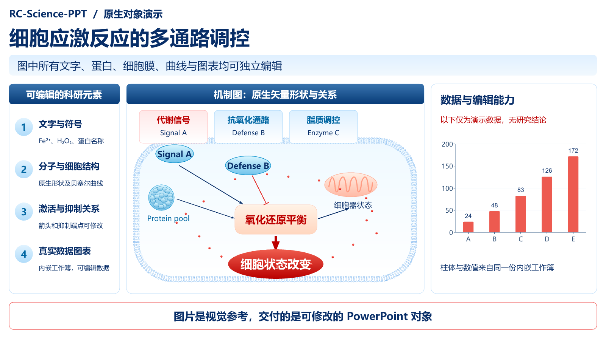

# RC-Science-PPT

**把科研幻灯片图片重建成真正可编辑的 PowerPoint。**

A reusable agent skill for rebuilding scientific slide images as editable PPTX.
Works with GPT Image 2.5 outputs, ordinary slide screenshots, and scientific
mechanism diagrams. Optional Image 2.5 generation is supported.



这张原创合成示例包含原生文本、细胞膜、蛋白团、线粒体、激活/抑制关系和内嵌数据工作簿。
示例数字没有科研含义；示例并非 Image 2.5 生成，也不作为自动图片识别精度基准。

## 能做什么

- 尽量保留原图的版式、配色、字体层级和文本内容。
- 将文字、标签、箭头、抑制端点和主要机制图形拆成独立 PowerPoint 对象。
- 支持原生渐变填充与可编辑贝塞尔曲线。
- 将明确可读的数据重建为原生图表及内嵌 Excel 工作簿。
- 保留无明确数值的图表外观，同时避免编造数据。
- 导出后检查结构、文字覆盖、对象边界及图表数据，并进行渲染对照。

**这是供视觉智能体使用的重建技能。** 智能体负责理解图片并制作场景描述；
随附 CLI 根据场景描述生成 PPTX，不会单独读取 PNG 就自动识别所有元素。
重建复杂插图需要判断和迭代，不能保证逐像素一致。

## 安装

将本仓库放到技能目录中的 `rc-science-ppt` 文件夹：

- Codex 用户级目录：`~/.codex/skills/rc-science-ppt/`
- 或放入你的工具支持的技能目录，确保能找到本仓库根目录的 `SKILL.md`。

可下载仓库 ZIP，解压后把根文件夹改名为 `rc-science-ppt`；也可以让技能安装器
根据本仓库 URL 安装。仓库/展示名为 **RC-Science-PPT**，调用标识为
`rc-science-ppt`，以兼容常见技能名称规范。

需要：能够看图和执行代码的智能体、Node.js 20+、Python 3.9+。
字体由使用者提供，中文推荐 Microsoft YaHei、PingFang SC 或 Noto Sans CJK SC。
从图片转 PPT 无需 OpenAI API Key。生图能力和模型访问权限由使用者所在环境提供。

在技能目录安装固定版本依赖：

```sh
npm ci --ignore-scripts
npm run check
npm test
```

## 使用

给智能体附上图片，输入：

> 使用 $rc-science-ppt，把这张科研汇报图片重建为可编辑 PPT。保持原来的版式与配色，
> 文字、机制图和箭头尽量使用原生对象。不要补写无法辨认的文字或图表数值。

一次交付多张图片时，默认每张对应一页，保持输入顺序和原图比例。

可选的完整流程：

> 使用 $rc-science-ppt，先用 GPT Image 2.5 生成一张科研机制图幻灯片，
> 再将生成图重建成可编辑 PPT。仅使用我提供的研究内容和数值。

CLI/自定义场景：

```sh
npm run demo
node scripts/build_pptx.mjs --scene scene.json --out build/result.pptx
python scripts/audit_pptx.py build/result.pptx --scene scene.json --min-text 1 --max-pictures 0
```

- [场景格式及可编辑对象](references/scene-format.md)
- [质量检查与渲染](references/quality.md)
- [Image 2.5 可选入口](references/image-2.5.md)
- [可编辑示例](examples/demo.pptx)
- [最小场景示例](examples/minimal.scene.json)

## 复现与边界

同一份场景源文件及固定版本依赖可以重复构建相同的对象结构；字体与渲染器仍会影响外观。
换一张图片时，视觉智能体需要重新识别、定位与校对内容，只有同一句提示词不能保证相同质量。
照片、显微图、复杂纹理等保留为局部图片时，应明确披露。不会把整页图片贴进 PPT 后称为可编辑。

自动测试验证原生文字、路径、渐变、图表与工作簿，以及对未知数据的拒绝处理。
结构检查不等于 PowerPoint 实机检查或视觉还原度评分。

## 开源

MIT License。代码、技能说明和原创合成示例可依许可证复用。
第三方模型、字体和用户输入图片各自的许可与访问条件仍然适用。
本仓库不分发模型权重、访问凭据、商业字体或私有运行库。
